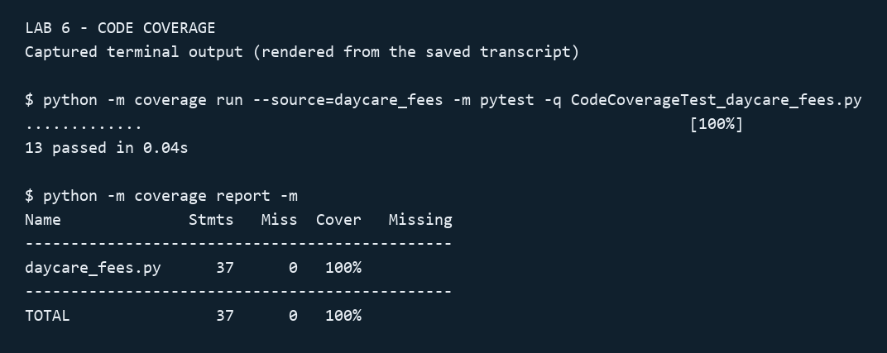
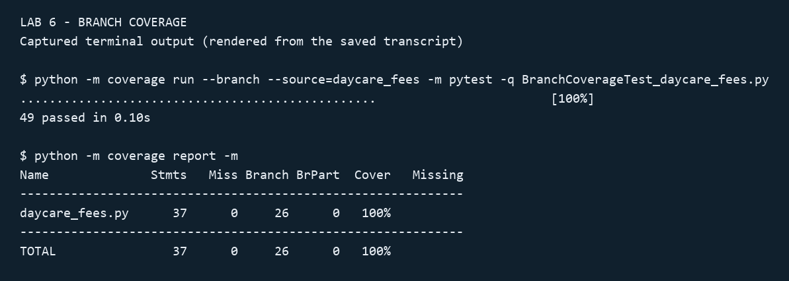

# Lab 6 - Code and Branch Coverage

Student: NAVEEN4516 (PES1UG24AM379)

Source: https://github.com/SETAPESU26/L6_L7_48_daycare_fees/tree/main/Lab%206
Fork: https://github.com/NAVEEN4516/L6_L7_48_daycare_fees

The original application and starter tests are retained unchanged.

## Reproduce code coverage

Run from this directory:

```powershell
python -m pip install -r requirements.txt
python -m coverage run --source=daycare_fees -m pytest -q CodeCoverageTest_daycare_fees.py
python -m coverage report -m
```

The 13 code coverage cases execute all 37 statements: **100% line coverage**.
The starter suite has 2 passing tests and 38% line coverage (23 missing statements).
Tests include invalid age groups and hours, included-hour limits, sibling allowances,
normal and premium rates, enrolment outcomes and all pickup statuses.



The image is a rendering of the actual captured terminal transcript in
`reports/code_coverage.txt`, rather than a desktop screenshot. The JSON report
provides machine-readable coverage evidence.

## Reproduce branch coverage

```powershell
python -m coverage run --branch --source=daycare_fees -m pytest -q BranchCoverageTest_daycare_fees.py
python -m coverage report -m
python -m pytest -q
```

The 49 branch and boundary cases cover **37/37 statements and 26/26 branches**,
with no partial branches: **100% line and 100% branch coverage**. Coverage.py's
combined `Cover` column is 100%; the JSON report independently records
`percent_branches_covered` as 100. The starter branch-enabled combined score
was 32%.



The image renders the actual saved terminal output in `reports/branch_coverage.txt`.
Native desktop screenshots could not be captured in this session.

## Analysis

Line coverage records executed statements. Branch coverage also checks the
alternative control-flow outcomes of decisions. Neither proves all possible
input combinations or correctness of the requirements.

The branch suite covers unknown groups, negative hours, all three valid groups,
both sibling values including the infant exception, exact included-hour limits,
20 versus 21 extra hours, fractional hours, enrolment ages 5/6 and 11/12,
zero/one vacancies, both immunisation states and all four aftercare/Friday
combinations. Pickup tests check each cutoff, one minute above and below it,
and the exact late/overdue boundary.

The pending-immunisation path currently uses age >= 12 without checking
vacancies. Its test documents existing behavior; no business-rule change is
assumed. Source application code was not modified.

`pytest.ini` includes the handout's capitalized filenames in test discovery.
The complete suite runs 64 tests (2 starter + 13 code + 49 branch).

## Deliverables

- `CodeCoverageTest_daycare_fees.py`: line coverage suite.
- `BranchCoverageTest_daycare_fees.py`: branch and boundary suite.
- `reports/`: final output images, exact text transcripts and JSON metrics.
- Two separate commits: code coverage followed by branch coverage.
